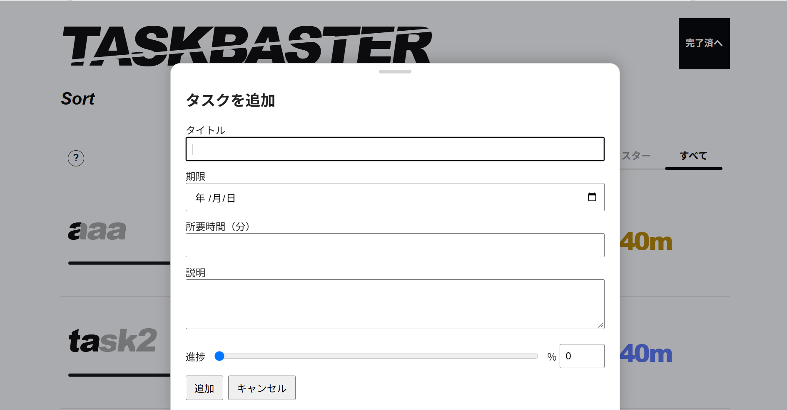
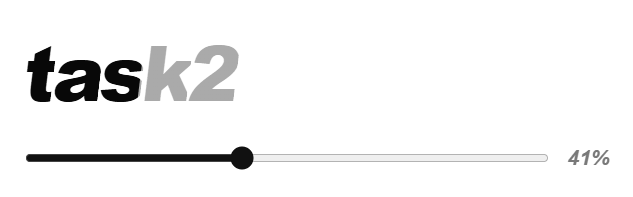
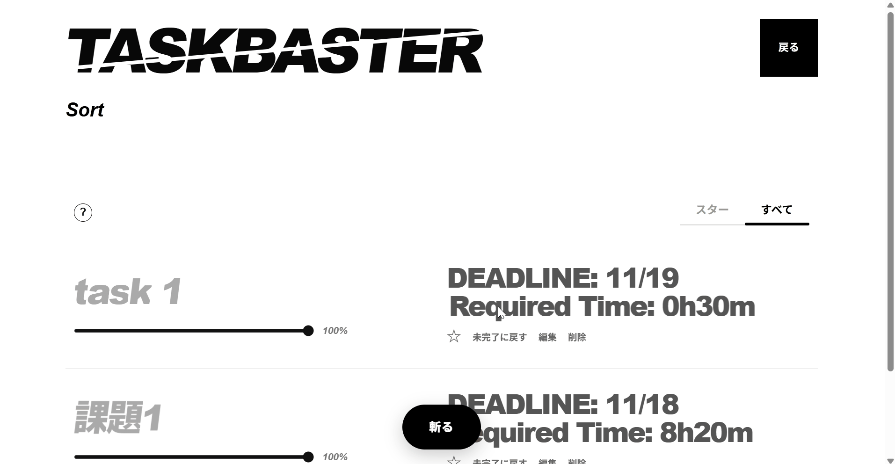
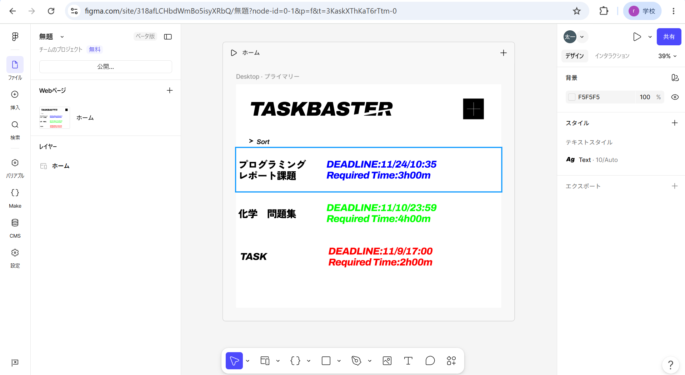
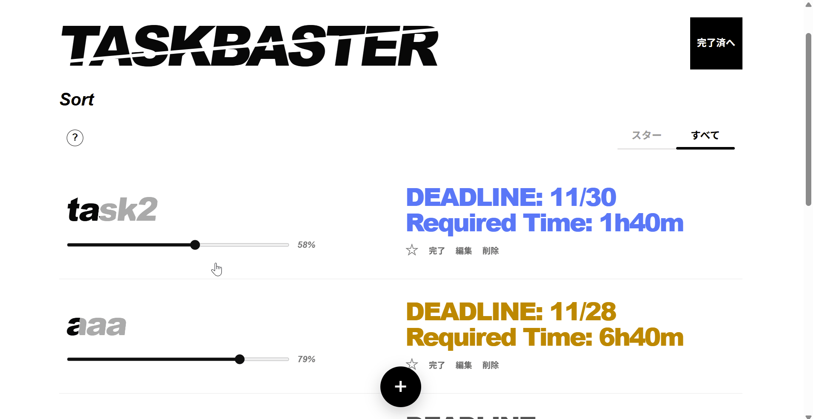

# タスク管理アプリ
## ページをデプロイしているgithub pages のURL
https://taichi-hagiwara.github.io/task_Baster/

## アプリの概要
このアプリ **TASKBASTER** はタスクを管理するだけでなく，破壊する爽快感を得られるtodoアプリです．React/Typescript/tailwind cssとthree.jsで構成しました．サイトのデザインには一部Figmaを使用しています


## 機能
- タスクはブラウザのlocalStorageに保存
- タスクを名前・説明・期限・推定所要時間・進捗度で管理


- 進捗バーをそのままタスク名にも反映して見やすく


- 期限と所要時間，進捗から推定して警告度を算出し，警告度の高さに応じて文字の色が赤(高),黄(中),青(低)に変化

- 完了済みタスクも確認でき，未完了状態に戻せる

- 完了済みタスク画面から別画面(タブ)に移行して，終わらせたタスクを斬ることができる． **スローモーションにして切り刻むことも可能** 
    - 左クリックで斬る・右クリック長押しでスロー・Q/Eまたはホイールで角度変更・斬った後はRで次のタスク



## 工夫した点
- UIのスッキリさを重視して，先にfigmaでUIのモックを作成→コード機能を使ってコード化したものを参考に作成
↓figmaでUIなどを仮置きしていた様子


- ヘッダのsortボタンと，画面下部のタスク追加ボタンはスクロールに追従して，いつでもアクセスできるようにした


- three.jsの難しい物理演算はRapierを使い，ものの切断はthree-bvh-csgなど既存のライブラリを使って難易度を軽減した

- フロントエンド部分は複数のコンポーネントに分割してコードを実装し，ゴチャつかないようにした

- 思ったよりファイルが増えてしまったので，JSXを書く必要のないファイルは忘れず.tsにして見分けがつきやすくした

## 手元でソースコードを動かす方へ
```cmd
npm ci
npm run dev
```

## 開発期間
10/29~11/26(約30時間)

## 技術スタック
- React
- Typescript
- Tailwind CSS
- Vite
- Three.js